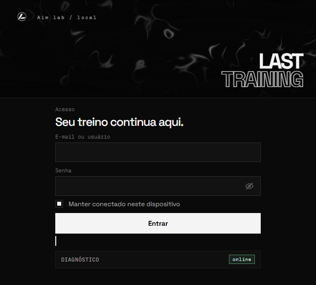
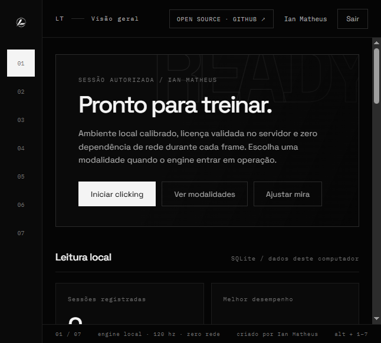
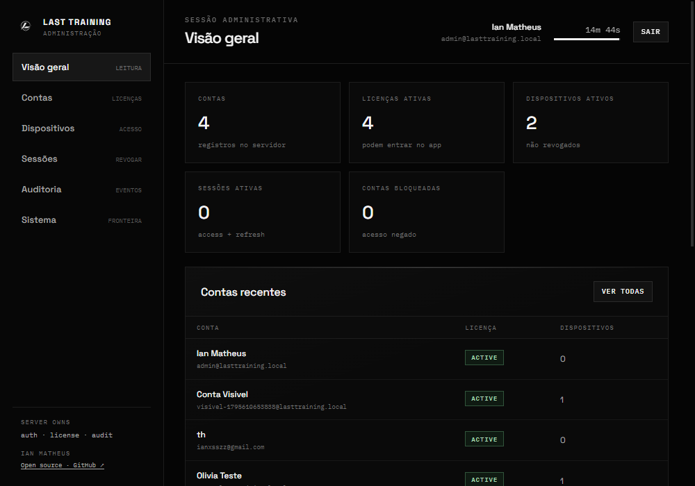

# Last Training

Aim trainer desktop para Windows 10 e 11, construído com Electron, React, TypeScript e SQLite. O projeto separa a experiência local da autorização: o app desenha, captura ponteiro, roda o engine e salva estatísticas; o servidor decide login, licença, dispositivos, sessões, auditoria e permissões administrativas.

**Open source por [Matheus](https://github.com/iammatheuszn).** O botão *Open source · GitHub* está disponível na tela de login, na barra do app e no painel administrativo.

## Projeto em imagens

Login do aplicativo, com diagnóstico de endpoint, licença e crédito open source:



Painel após autenticação, com sessão autorizada, leitura local de SQLite e acesso às modalidades:



Painel administrativo com contas, licenças, dispositivos, sessões e auditoria decididas no servidor:



## O que está incluído

- Electron com `contextIsolation`, `nodeIntegration: false`, `sandbox: true` e ponte IPC allowlisted.
- Login obrigatório: nenhuma tela interna abre sem sessão autenticada e licença ativa.
- API HTTPS-only no cliente, tokens de acesso curtos, refresh com rotação, nonce por requisição, rate limit e bloqueio por falhas de login.
- Licenças `active`, `expired`, `suspended`, `canceled` e `blocked`, com limite de dispositivos validado no servidor.
- Estatísticas locais em SQLite, sem números fictícios.
- Overlay de crosshair, modalidades de clicking, tracking, flick, switching, precisão, velocidade e treinos de crosshair.
- Painel administrativo em React + TypeScript, servido apenas pelo backend em `/admin`.
- Backup, restore, exportação de auditoria, healthcheck real, updates assinados com Ed25519 e verificações de integridade.
- Smoke tests isolados para produção, release, instalador, disaster recovery, abuso e bundle.

## Começando

Requisitos: Node.js 22+, npm e Windows 10/11.

```powershell
npm install
npm run dev
```

`npm run dev` prepara o certificado HTTPS local, grava `config/runtime.json`, cria o segredo de desenvolvimento quando necessário, sobe o backend se ele ainda não estiver ativo e inicia Vite + Electron. No Windows, `start-last-training.bat` faz o mesmo fluxo.

## Conta de demonstração

Uma conta administrativa é criada automaticamente na primeira inicialização local, com senha armazenada apenas como hash scrypt:

```text
email: admin@lasttraining.local
senha: LastTrainingAdmin2026!
```

Ela entra no app desktop e em `/admin`. A criação automática é desligada quando `LT_ENV=production`; em produção, use `npm run seed:admin` com credenciais próprias.

A conta antiga de teste `teste@lasttraining.local` / `LastTrainingTeste2026!` continua válida em bancos locais existentes.

## Painel administrativo

Com o backend ativo, abra:

```text
https://127.0.0.1:8787/admin
```

O painel permite criar contas, consultar IP e HWID por dispositivo, alterar licenças, bloquear contas, revogar dispositivos e sessões, redefinir senhas e ler auditoria. Nenhuma credencial ou regra confidencial viaja no bundle: o frontend apenas chama `/v1/admin/*`.

Criar outro administrador pela CLI:

```powershell
npm run seed:admin -- --email admin@seu-dominio --password "senha-longa-e-aleatoria" --display "Seu nome" --plan pro
```

## Estrutura

```text
src/main/       processo principal: sessão, IPC, integridade, updates e overlay
src/preload/    ponte mínima via contextBridge
src/renderer/   interface, design system, gate de login e engine
src/overlay/    renderer transparente do crosshair
server/         API, SQLite, autenticação, licenças, auditoria e /admin
admin-web/      dashboard administrativo React + TypeScript
scripts/        dev, build, release, backup, smoke tests e bundle
deploy/         modelos de Caddy, Nginx e notas de deploy
```

## Comandos

```powershell
npm run dev                 # ambiente local completo
npm run build               # build do painel, do app, ofuscação e integridade
npm run test:all            # testes do servidor e do cliente
npm run acceptance          # gate completo: testes, build, preflight e smokes
npm run build:admin         # compila apenas o painel administrativo
npm run backup:create       # backup consolidado do SQLite
npm run audit:export        # exporta auditoria em jsonl, json ou csv
npm run preflight           # valida runtime, config, banco, TLS e updates
npm run dist                # release NSIS assinado com Authenticode
npm run dist:unsigned       # release sem certificado, para ensaio local
npm run bundle              # pacote de deploy com manifesto SHA-256
```

`npm run acceptance` roda nove etapas em sequência: `test:all`, `build`, `preflight --json`, `smoke:production`, `smoke:release`, `smoke:installer`, `smoke:dr`, `smoke:abuse` e `smoke:bundle`. Cada smoke usa banco, certificados e chaves temporários.

## Diagnóstico de login

A tela de login mostra endpoint e origem, validação HTTPS, resultado do `/health`, latência, HTTP, último código do servidor e `request id`. O relatório copiado remove senha, bearer e tokens. Erros como `NOT_CONFIGURED`, `INSECURE_ENDPOINT` e códigos devolvidos pelo backend aparecem separados, sem máscara genérica.

## Produção

Copie `.env.example` para `.env`, preencha os valores reais e rode o preflight:

```powershell
npm run preflight -- --production --url=https://app.seu-dominio.com
```

São obrigatórios `AUTH_JWT_SECRET` com 32+ caracteres, `LT_PUBLIC_ORIGIN` HTTPS, `LT_DB_PATH` explícito e TLS local ou `LT_TLS_TERMINATED=true`. Modelos de reverse proxy e o fluxo de backup/restore estão em `deploy/README.md`.

Para gerar o instalador público são necessários `WIN_CSC_LINK`, `WIN_CSC_KEY_PASSWORD`, `LT_PUBLISHER_NAME`, `LT_UPDATE_URL` e `LT_UPDATE_PRIVATE_KEY_PATH`. O feed `latest.json` é assinado com Ed25519 e verificado antes de qualquer download.

## License

MIT. Use, estude, modifique e publique com crédito.

## Créditos

Desenvolvido por [Matheus](https://github.com/iammatheuszn).
